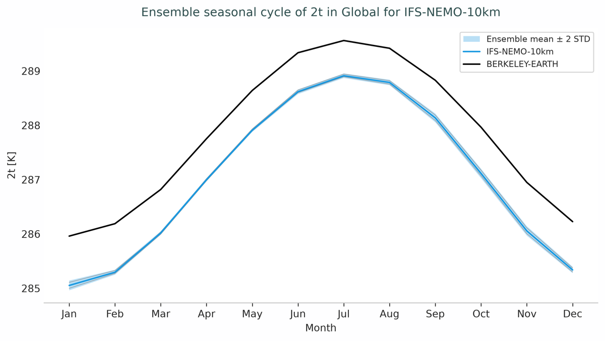
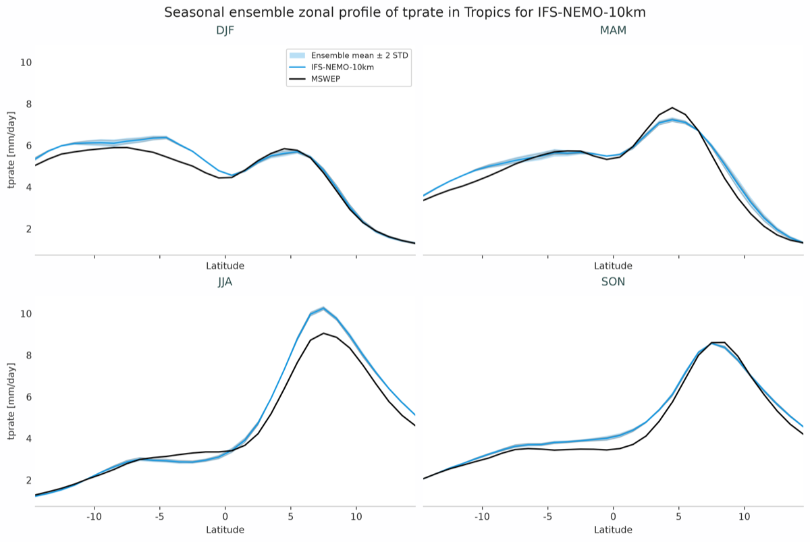

.. _ensemble_profiles:

Ensemble Profiles diagnostic
============================

Description
-----------

The **EnsembleProfiles** diagnostic provides tools to compute and visualize ensemble statistics of 1D data:

- Latitude profiles, for the whole period and for each season.
- Seasonal cycles.

Classes
-------

There is one class for the analysis and one for plotting:

* **EnsembleProfiles**: computes the ensemble mean and standard deviation. All the dimensions except for the ensemble one are preserved.
  Results are saved as class attributes and as NetCDF files.

* **PlotEnsembleProfiles**: plots the members, the ensemble mean with a band of two standard deviations, and the reference.
  It produces a single plot, or one panel per selection with the ``panels`` argument.

File structure
--------------

* The diagnostic is located in the ``aqua/diagnostics/ensemble`` directory.
* An example is available in the ``notebooks/diagnostics/ensemble/ensemble_profiles.ipynb`` notebook.

Input variables and datasets
----------------------------

The input is the ``zonal_profile`` output of the LatLon Profiles diagnostic and the ``seasonalcycles`` output of the Timeseries diagnostic, merged along the ``ensemble`` dimension.

Basic usage
-----------

.. code-block:: python

    from aqua.diagnostics import EnsembleProfiles, PlotEnsembleProfiles, merge_from_data_files

    dataset = merge_from_data_files(variable='2t', data_path_list=file_list)

    ens = EnsembleProfiles(
        var='2t',
        dataset=dataset,
        diagnostic_product='EnsembleSeasonalCycles',
        region='global',
    )
    ens.run()

    plot = PlotEnsembleProfiles(diagnostic_product='EnsembleSeasonalCycles', region='global')
    plot.plot(
        var='2t',
        mean=ens.dataset_mean,
        std=ens.dataset_std,
        members=dataset['2t'],
        coord='month',
        data_name='seasonal_cycle',
    )

Use a different ``diagnostic_product`` for each kind of profile so that the outputs do not overwrite each other.

Configuration
-------------

In ``aqua analysis ensemble``, the products are enabled with the ``seasonalcycles`` and ``lat_lon_profiles`` blocks:

.. code-block:: yaml

    seasonalcycles:
      run: true
      diagnostic_name: 'atmosphere2d'
      variables: ['2t']
      params:
        2t:
          regions: ['global', 'europe']

    lat_lon_profiles:
      run: true
      diagnostic_name: 'atmosphere2d'
      mean_type: 'zonal'
      variables:
        - name: '2t'
          regions: [null, 'tropics']  # global and tropics

The ``regions`` must be available in the output of the realizations.
The longterm and seasonal latitude profiles are stacked along a ``period`` dimension, so there is one NetCDF file per statistic and region.

Output
------

* NetCDF files with the ensemble mean and standard deviation.
* Seasonal cycles: one figure per variable and region.
* Latitude profiles: one longterm figure and one figure with four seasonal panels per variable and region.

Example plots
-------------

   Global seasonal cycle of 2 metre temperature of three IFS-NEMO members and Berkeley Earth.

   Seasonal latitude profiles of precipitation in the tropics of three IFS-NEMO members and MSWEP.
