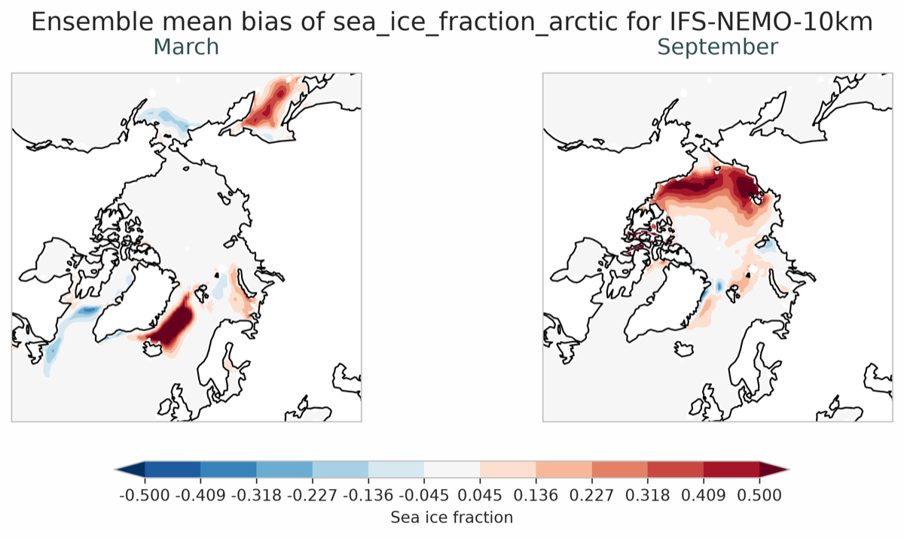

.. _ensemble_seaice:

Ensemble Sea Ice diagnostic
===========================

Description
-----------

The sea ice ensemble computes the ensemble mean and standard deviation of the monthly climatologies of sea ice fraction and thickness, for each hemisphere.

Classes
-------

The diagnostic has no dedicated classes: ``EnsembleMaps`` and ``PlotEnsembleMaps`` are used as they are for the statistics, since they preserve the ``month`` dimension.
The differences from the other maps are handled as follows:

* The input files hold one variable per hemisphere, such as ``sea_ice_fraction_arctic``, so each hemisphere is processed on its own.
* The figures show selected months with ``PlotEnsembleMaps.plot_seasonal()`` and its ``dim``, ``panels`` and ``extent`` arguments.
* The reference depends on the method and the hemisphere, so it is set in the configuration of the diagnostic.
* The reference covers one hemisphere only: the difference is computed on the latitudes it shares with the model.

File structure
--------------

* The orchestration is in ``run_seaice_maps`` in ``aqua/diagnostics/ensemble/cli_ensemble.py``.
* An example is available in the ``notebooks/diagnostics/ensemble/ensemble_seaice.ipynb`` notebook.

Input variables and datasets
----------------------------

The input is the ``bias`` output of the sea ice diagnostic.
Its filename contains the source the realization was produced from, which may differ from the ``--source`` given to ``aqua analysis ensemble``, so that part of the filename is matched with a wildcard.

Basic usage
-----------

.. code-block:: python

    from aqua.diagnostics import EnsembleMaps, PlotEnsembleMaps, merge_from_data_files

    variable = 'sea_ice_fraction_arctic'
    dataset = merge_from_data_files(variable=variable, data_path_list=file_list)

    ens = EnsembleMaps(
        var=variable,
        dataset=dataset,
        diagnostic_product='EnsembleSeaIceMaps',
        region='arctic',
    )
    ens.run()

    plot = PlotEnsembleMaps(diagnostic_product='EnsembleSeaIceMaps', region='arctic')
    plot.plot_seasonal(
        var=variable,
        dataset=ens.dataset_mean,
        dim='month',
        panels=[3, 9],
        titles=['March', 'September'],
        proj='nh_polar_stereo',
        extent=[-180, 180, 50, 90],
        figsize=(10, 5),
        data_name='ensemble_mean',
    )

Configuration
-------------

The product is enabled with the ``seaice_2d_bias`` block of ``config-seaice-ensemble.yaml``:

.. code-block:: yaml

    seaice_2d_bias:
      run: true
      diagnostic_name: 'seaice'
      methods: ['fraction', 'thickness']
      regions: ['arctic', 'antarctic']
      months: [3, 9]
      references:
        fraction:
          arctic: {catalog: 'obs', model: 'OSI-SAF', exp: 'osi-saf-ssmis', source: 'nh-monthly'}
          antarctic: {catalog: 'obs', model: 'OSI-SAF', exp: 'osi-saf-ssmis', source: 'sh-monthly'}

The ``plot_params`` section sets the projection and extent of each region and the colour limits of each method.

Output
------

For each method and hemisphere: NetCDF files with the ensemble mean and standard deviation of all the months, and figures of the mean, the standard deviation and the bias for the selected months.

Example plot
------------

   Difference between the ensemble mean sea ice fraction of three IFS-NEMO members and OSI-SAF, in March and September.
