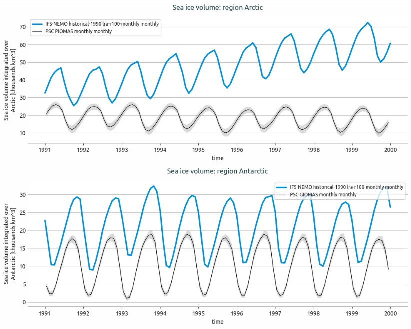
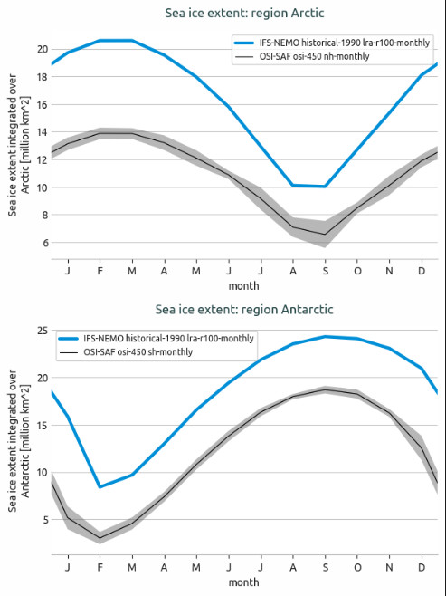
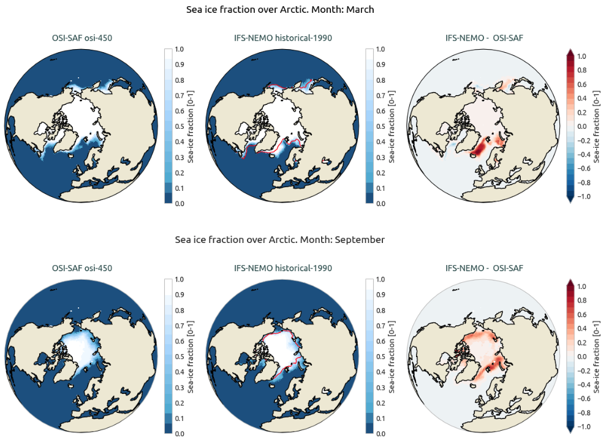
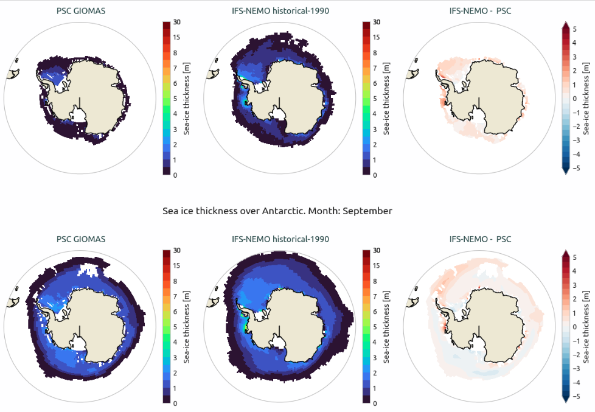

.. _seaice:

Sea Ice Diagnostic
==================

Description
-----------

The **SeaIce** diagnostic is a set of tools for the analysis and visualization of sea ice metrics from climate model outputs.
It supports analysis of sea ice extent, volume, fraction, and thickness.

SeaIce provides tools to plot:

- Time series of sea ice extent and volume, optionally with their annual means
- Seasonal cycles of sea ice extent and volume
- Uncertainty bands of the reference datasets (two standard deviations) on both
- Maps of the sea ice fraction and thickness climatology of a model, of a reference dataset and of their difference

Time series and seasonal cycles can be computed over a specific region of the Northern or Southern Hemisphere.
Default regions are the Arctic and the Antarctic regions, but it is possible to select other regions and custom regions
can be defined in the configuration file.

Two main components are included:

- A class that performs the computations and prepares the data (including saving NetCDF files).
- Separate classes for producing 1D (time series) and 2D (maps) visualizations.

Classes
-------

There is one class for the analysis and two for the plotting:

* **SeaIce**: computes the sea ice metrics of a single model or reference dataset over a list of regions.
  ``run()`` retrieves the data and computes one ``method`` at a time, storing each result as an attribute:
  a ``xarray.Dataset`` with one variable per region, named ``sea_ice_<method>_<region>``.

  - **Integrated methods** (one value per time step and region):

    - ``extent``: area of the grid cells with a sea-ice concentration above ``threshold`` (default: 15%), in million km².
    - ``volume``: integral of the sea-ice thickness over the region, in thousands km³.

    They fill ``monthly`` (the time series) and, on request, ``annual`` (annual means of the complete years),
    ``seasonalcycle`` (mean by calendar month, instead of the time series), ``std_monthly`` and ``std_annual``
    (standard deviation by calendar month and of the annual means). The standard deviation covers the period
    between ``std_startdate`` and ``std_enddate`` if they are given, the analysis period otherwise.

  - **Map methods** (monthly climatology maps, in ``climatology``):

    - ``fraction``: sea-ice concentration (0-1).
    - ``thickness``: sea-ice thickness (in meters).

  ``save_netcdf()`` writes the results of the last run and ``load()`` reads them back in a new instance, without
  retrieving any data.

* **PlotSeaIce**: draws the time series or the seasonal cycles of one or more models, with reference datasets
  and their uncertainty bands, in one panel per region. It takes the results of ``SeaIce`` as they are
  (a ``xarray.Dataset`` or a list of them) and reads models, regions and periods from their attributes.

* **Plot2DSeaIce**: draws, for each region, the maps of a reference dataset, of a model and of their difference,
  one row per month. It takes the ``climatology`` of ``SeaIce`` for the models and for the references.

File structure
--------------

* The diagnostic is located in the ``aqua/diagnostics/seaice`` directory, which contains both the source code and the command line interface (CLI) script.
* A template configuration file is available at ``aqua/diagnostics/templates/collections/config-seaice.yaml``
* Regional definitions are available in ``aqua/diagnostics/config/definitions/regions.yaml``.
* Notebooks are available in the ``notebooks/diagnostics/seaice`` directory and contain examples of how to use the diagnostic.

Input variables and datasets
----------------------------

The diagnostic supports the following variables (the ``Fixer`` class of AQUA-core can convert different variable names into the accepted format):

* ``siconc`` (sea ice concentration, GRIB parameter id 31)
* ``sithick`` (sea ice thickness, GRIB parameter id 32)

The default reference dataset for sea ice concentration is OSI-SAF, but custom references can be provided in the configuration file.

The diagnostic is designed to work with data from the Low Resolution Archive (LRA), generated by
the Data Reduction OPerator (DROP) of the AQUA project, which provides monthly data at a 1x1
degree resolution.

Basic usage
-----------

The basic usage of this diagnostic is explained with working examples in the notebooks.
The basic structure of the analysis is the following:

**Time Series**

.. code-block:: python

    from aqua.diagnostics import SeaIce, PlotSeaIce

    # Sea ice extent of the model over the default regions (Arctic and Antarctic)
    si = SeaIce(model='IFS-NEMO', exp='historical-1990', source='lra-r100-monthly')
    si.run(method='extent')

    # Reference with the standard deviation by calendar month: one dataset per hemisphere
    ref_nh = SeaIce(catalog='obs', model='OSI-SAF', exp='osi-saf-ssmis', source='nh-monthly',
                    regrid='r100', regions='arctic')
    ref_nh.run(method='extent', std=True)

    # Plot time series
    psi = PlotSeaIce(monthly_models=si.monthly, monthly_ref=ref_nh.monthly, monthly_std_ref=ref_nh.std_monthly)
    psi.plot_seaice(plot_type='timeseries', save_format=['png', 'pdf'])

``run(method='extent', annual=True)`` also fills ``si.annual``, to be passed as ``annual_models`` (``annual_ref`` and
``annual_std_ref`` for a reference), while ``run(method='extent', seasonal_cycle=True)`` fills ``si.seasonalcycle``,
to be plotted with ``plot_type='seasonalcycle'``.

**2D Spatial**

.. code-block:: python

    from aqua.diagnostics import SeaIce, Plot2DSeaIce

    # Monthly climatology of the sea ice fraction of the model
    si = SeaIce(model='IFS-NEMO', exp='historical-1990', source='lra-r100-monthly')
    si.run(method='fraction')

    # Reference data, one dataset per hemisphere
    ref_nh = SeaIce(catalog='obs', model='OSI-SAF', exp='osi-saf-ssmis', source='nh-monthly',
                    regrid='r100', regions='arctic')
    ref_nh.run(method='fraction')
    ref_sh = SeaIce(catalog='obs', model='OSI-SAF', exp='osi-saf-ssmis', source='sh-monthly',
                    regrid='r100', regions='antarctic')
    ref_sh.run(method='fraction')

    # Plot reference, model and difference maps for March and September
    psi_2d = Plot2DSeaIce(models=si.climatology, ref=[ref_nh.climatology, ref_sh.climatology])
    psi_2d.plot_2d_seaice(method='fraction', months=[3, 9], projection='orthographic',
                          plot_ref_contour=True,
                          save_format=['png', 'pdf'])  # optional; default is SAVE_FORMAT (['png', 'pdf', 'svg'])

.. note::

   If not specified otherwise, the results are saved as NetCDF files and the plots using ``SAVE_FORMAT``
   (PNG, PDF, and SVG) in the current working directory. Both follow the ``outputdir`` argument.

CLI usage
---------

The diagnostic can be run from the command line interface (CLI) by running the following command:

.. code-block:: bash

    python -m aqua.diagnostics.seaice.cli_seaice --config <path_to_config_file>

Additionally, the CLI can be run with the following optional arguments:

- ``--config``, ``-c``: Path to the configuration file, e.g. ``aqua/diagnostics/config/collections/legacy/seaice/config-seaice-osi.yaml`` or ``config-seaice-psc.yaml``.
- ``--nworkers``, ``-n``: Number of workers to use for parallel processing.
- ``--cluster``: Cluster to use for parallel processing. By default a local cluster is used.
- ``--loglevel``, ``-l``: Logging level. Default is ``WARNING``.
- ``--catalog``: Catalog to use for the analysis. Can be defined in the config file.
- ``--model``: Model to analyse. Can be defined in the config file.
- ``--exp``: Experiment to analyse. Can be defined in the config file.
- ``--source``: Source to analyse. Can be defined in the config file.
- ``--outputdir``: Output directory for the plots.
- ``--proj``: Projection type for 2D plots. Choices are 'orthographic' or 'azimuthal_equidistant'. Default is 'orthographic'.
- ``--startdate``: Start date for the analysis.
- ``--enddate``: End date for the analysis.

Configuration file structure
----------------------------

The configuration file is a YAML file that contains the details on the dataset to analyse or use as reference,
the output directory and the diagnostic settings.
Most of the settings are common to all the diagnostics (see :ref:`diagnostics-configuration-files`).
Here we describe only the specific settings for the sea ice diagnostic.

The sea ice configuration file is organized into several main sections:

**Dataset Configuration:**

.. code-block:: yaml

    datasets:
      - catalog: null              # mandatory as null
        model: 'IFS-NEMO'          # mandatory
        exp: 'historical-1990'     # mandatory
        source: 'lra-r100-monthly' # mandatory
        regrid: null               # if the diagnostic supports it

**Reference Datasets:**

.. code-block:: yaml

    references:
      - catalog: 'obs'             # mandatory
        model: 'OSI-SAF'           # mandatory
        exp: 'osi-saf-ssmis'       # mandatory
        source: 'nh-monthly'       # mandatory
        regrid: 'r100'
        domain: 'nh'
        methods: ['extent', 'fraction']
        startdate: '1991-01-01'
        enddate: '2000-12-31'

The references are listed once and used by all the tools. Besides the usual keys, each reference can have:

- ``domain``: the hemisphere covered by the dataset (``nh`` or ``sh``): the reference is compared with the regions
  of that hemisphere only. Without it, the reference is used for all the regions.
- ``methods``: the sea ice methods the reference is used for. Without it, the reference is used for all the methods:
  this is the case of the collection files, which hold one family of references each (``config-seaice-osi``
  for ``extent`` and ``fraction``, ``config-seaice-psc`` for ``volume`` and ``thickness``).
- ``std_startdate``, ``std_enddate``: the period of the standard deviation (see below).

**Diagnostic Blocks:**

There are three tool blocks, ``seaice_timeseries``, ``seaice_seasonal_cycle`` and ``seaice_2d_bias``,
with the same layout:

.. code-block:: yaml

    seaice_timeseries:
      run: true
      diagnostic_name: 'seaice'       # prefix of the output files
      methods: ['extent', 'volume']   # Methods to compute
      params:
        default:
          regions: ['arctic', 'antarctic']  # Regions to analyze
          std: true                         # +/- 2 std band around the references
          annual: false                     # also plot the annual means (seaice_timeseries only)

- ``methods``: ``extent`` and ``volume`` for ``seaice_timeseries`` and ``seaice_seasonal_cycle``,
  ``fraction`` and ``thickness`` for ``seaice_2d_bias``.
- ``params.default``: options of the computation for all the methods; ``params.<method>`` overrides them for one method.

  - ``regions``: names from the regions file (see :ref:`diagnostics-regions`).
  - ``std``: compute the standard deviation of the references by calendar month and draw it as a band of two
    standard deviations. It covers ``std_startdate`` - ``std_enddate``, given here or in the reference entry,
    or the analysis period of the reference if they are missing.
  - ``annual``: also compute and plot the annual means of models and references (and their standard deviation with
    ``std``). Only complete years are used: with less than one, the annual means are skipped with a warning.
  - ``ref_startdate``, ``ref_enddate``: analysis period of the references for this tool, when it differs from
    the one of the reference entry.
  - ``var``: variable to use, by default ``siconc`` for ``extent`` and ``fraction``, ``sithick`` for ``volume``
    and ``thickness``. It is usually set for one method, e.g. ``params.volume.var``.

**2D Bias Configuration:**
The ``seaice_2d_bias`` block also has the months to plot:

.. code-block:: yaml

    seaice_2d_bias:
      run: true
      diagnostic_name: 'seaice'
      methods: ['fraction', 'thickness']
      params:
        default:
          regions: ['arctic', 'antarctic']
      plot_params:
        default:
          months: [3, 9]                # Months to plot (March and September)

The maps are centred on the pole of each region. The projection is chosen with the ``--proj`` option of the CLI:
``orthographic`` (default) or ``azimuthal_equidistant``, which cuts the map to a circle poleward of 50 degrees.

Output
------

The diagnostic produces three types of figures:

* Time series plots of sea ice extent and volume for specified regions
* Seasonal cycle plots with optional standard deviation bands
* Maps of sea ice fraction and thickness of the reference, of the model and of their difference

Plots are saved in PDF, PNG, and SVG format by default (see ``SAVE_FORMAT``) and named
``seaice.<product>.<catalog>.<model>.<exp>.<realization>.<method>.<regions>``, with ``timeseries``, ``seasonalcycle``
or ``bias`` as product; the maps also have the model and the experiment of the reference before the method.

The results of every dataset and reference are saved as NetCDF files named
``seaice.<product>.<catalog>.<model>.<exp>.<realization>.<method>.<source>.<regions>.nc``, where the product is
``timeseries``, ``timeseries_annual``, ``seasonalcycle`` or ``bias`` (the climatology maps), followed by ``_std``
for the standard deviations.

Observations
------------

The default reference datasets are:

* OSI-SAF for sea ice concentration metrics (``extent``, ``fraction``)
* PSC (PIOMAS for Arctic, GIOMAS for Antarctic) for sea ice thickness metrics (``volume``, ``thickness``)

Details are available on the `OSI-SAF website <https://osi-saf.eumetsat.int/>`_.

An updated OSI-SAF version is available in the AQUA ``obs`` catalog (``exp=osi-saf-ssmis``), which concatenates OSI-SAF osi-450-a1 (1979-2021) and OSI-SAF osi-430 (2022-2025) datasets.

Custom reference datasets can be configured in the configuration file.

Example Plots
-------------

All plots can be reproduced using the notebooks in the ``notebooks`` directory on LUMI HPC.

   Time series of sea ice volume for Arctic and Antarctic regions.

   Seasonal cycle of sea ice extent for Arctic and Antarctic regions

   Sea ice fraction maps for the Arctic region (March and September).

   Sea ice thickness maps for the Antarctic region (March and September).

Available demo notebooks
------------------------

Notebooks are stored in ``notebooks/diagnostics/seaice``:

- `seaice_timeseries.ipynb <https://github.com/DestinE-Climate-DT/AQUA-diagnostics/tree/main/notebooks/diagnostics/seaice/seaice_timeseries.ipynb>`_
- `seaice_seasonalcycle.ipynb <https://github.com/DestinE-Climate-DT/AQUA-diagnostics/tree/main/notebooks/diagnostics/seaice/seaice_seasonalcycle.ipynb>`_
- `seaice_2d.ipynb <https://github.com/DestinE-Climate-DT/AQUA-diagnostics/tree/main/notebooks/diagnostics/seaice/seaice_2d.ipynb>`_

References
----------

* Lavergne, T., Sørensen, A. M., Kern, S., Tonboe, R., Notz, D., Aaboe, S., Bell, L., Dybkjær, G., Eastwood, S., Gabarro, C., Heygster, G., Killie, M. A., Brandt Kreiner, M., Lavelle, J., Saldo, R., Sandven, S., & Pedersen, L. T. (2019). Version 2 of the EUMETSAT OSI SAF and ESA CCI sea-ice concentration climate data records. The Cryosphere, 13(1), 49-78. https://doi.org/10.5194/tc-13-49-2019.

* Knowles, K., E. G. Njoku, R. Armstrong, and M. J. Brodzik. 2000. Nimbus-7 SMMR Pathfinder Daily EASE-Grid Brightness Temperatures, Version 1. Boulder, Colorado USA. NASA National Snow and Ice Data Center Distributed Active Archive Center. https://doi.org/10.5067/36SLCSCZU7N6.

Authors and contributors
------------------------

This diagnostic is maintained by Emanuele Tovazzi (`@tovaz92 <https://github.com/tovaz92>`_, `emanueletovazzi@cnr.it <mailto:emanueletovazzi@cnr.it>`_).
Contributions are welcome — please open an issue or a pull request.
For questions or suggestions, contact the AQUA team or the maintainers.

Detailed API
------------

This section provides a detailed reference for the Application Programming Interface (API) of the ``seaice`` diagnostic,
produced from the diagnostic function docstrings.

.. automodule:: aqua.diagnostics.seaice
    :members:
    :undoc-members:
    :show-inheritance:
